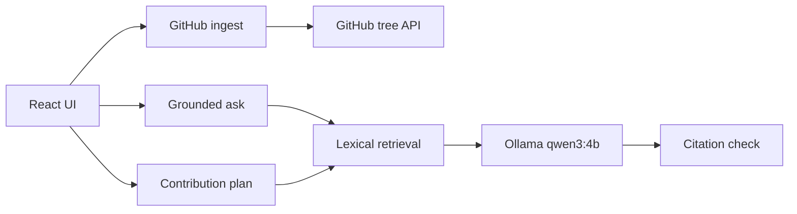

# Architecture

The browser never calls Ollama directly. Server functions in `src/lib/repoready/model.functions.ts` and `src/lib/repoready/github.functions.ts` perform GitHub and model requests.

Indexing (`src/lib/repoready/indexer.ts` and `ingest.ts`) reads the Git tree, drops secrets, binaries, lockfiles, and dependency directories, then fetches at most 24 text files and 96,000 characters.

Retrieval runs before any model call. If nothing matches, the model is not called. A citation is valid only when its path is in the passages supplied to that call, the line range exists in the source file, and the range sits inside one of those passages without crossing a gap. One retry is allowed. A failed check is shown as a verification warning. Coverage flags are computed from files that were actually stored, after downloads finish. A truncated tree, a skipped candidate, a failed download, or truncated file text marks the index incomplete.

When Ollama is down, timeout, or returns malformed JSON, the same screen shows the evidence draft and states that it is not a model answer.

The host project still contains authentication, database, multiplayer, and PWA files because the application root imports them. RepoReady's onboarding features do not use those services. They were left in place so the existing build and preview keep working.

## Environment

| Variable | Default | Purpose |
| --- | --- | --- |
| `OLLAMA_BASE_URL` | `http://127.0.0.1:11434` | Local Ollama server |
| `OLLAMA_MODEL` | `qwen3:4b` | Model name |
| `OLLAMA_TIMEOUT_MS` | `45000` | Generate timeout |
